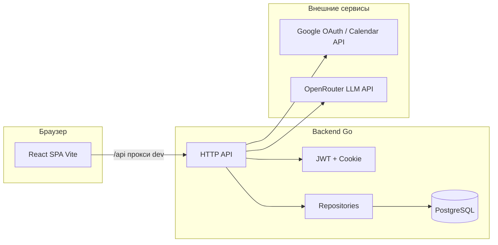

# Архитектура Pocketsecret

## Высокоуровневая схема

## Разделение ответственности

| Слой | Роль |
|------|------|
| **Frontend** | UI, клиентская навигация, хранение access token в памяти, вызовы `/api/*`. |
| **Backend** | Аутентификация, бизнес-правила, квоты, интеграции Google и OpenRouter, миграции БД. |
| **PostgreSQL** | Пользователи, связка с Google, бэклог, квоты smart-task, кэш советов, отметки «событие выполнено». |

## Аутентификация (модель сессии)

1. При регистрации/логине/refresh сервер выдаёт **access token** (JWT) в JSON и ставит **refresh token** в HttpOnly cookie `refresh_token`.
2. Запросы к защищённым эндпоинтам используют `Authorization: Bearer <access>`.
3. При загрузке приложения фронт вызывает `POST /api/auth/refresh` с `credentials: 'include'`, чтобы восстановить сессию по cookie.
4. OAuth Google для календаря запускается отдельным потоком: пользователь уже должен иметь refresh cookie; `state` в OAuth подписан JWT (см. `security.TokenManager`).

Подробности — [backend.md](./backend.md).

## Интеграции

### Google Calendar

- Приложение хранит refresh token Google в таблице `user_google_calendar`.
- Скоупы: чтение календаря, создание/изменение событий (для smart-task и планирования из бэклога).
- События для UI подгружаются через backend (прокси к Google API), а не напрямую из браузера.

### OpenRouter (LLM)

- **Умные задачи** (`/api/calendar/smart-task`): длинная операция; может возвращаться `202` с `job_id` и опросом `GET …?job=…` (in-memory job store на сервере).
- **Ежедневный совет** (`/api/calendar/daily-advice`): ответ кэшируется в БД по `(user_id, day)` с учётом сигнатуры событий.

Без настроенных ключей и Google часть функций возвращает понятные ошибки или `503`/`400`.

## Фронтенд как SPA

- Один бандл React, маршруты через `react-router-dom`.
- В dev Vite проксирует `/api` на `http://127.0.0.1:8080` с увеличенным таймаутом (умные задачи).
- Статические аватары отдаются с бэкенда: `/api/static/avatars/…`.

## Надёжность и ограничения (важно для онбординга)

- **Smart-task jobs** хранятся в памяти процесса: при рестарте сервера активные job теряются; для продакшена при необходимости понадобится очередь (Redis и т.д.).
- Квота **free** smart-task считается по UTC-дню в таблице `user_daily_smart_tasks`; лимит настраивается (`FREE_SMART_TASK_LIMIT`), для **pro** квота не применяется в том же виде.

## Связанные документы

- Структура каталогов и файлов: [backend.md](./backend.md), [frontend.md](./frontend.md).
- Таблицы и миграции: [database.md](./database.md).
- Поведение продукта и безопасность: [mechanics-and-security.md](./mechanics-and-security.md).
